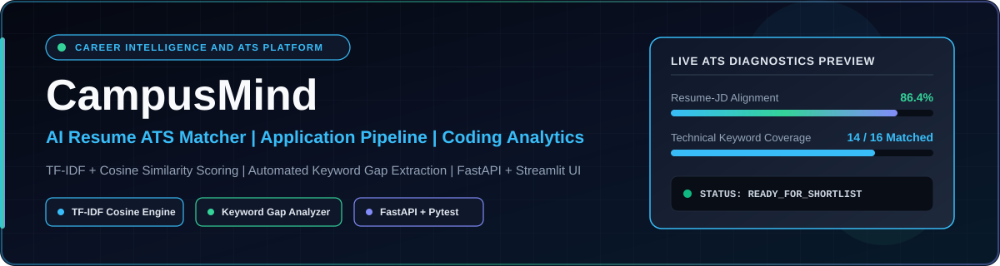
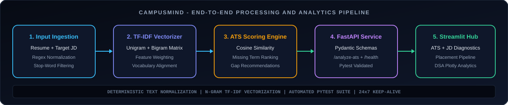
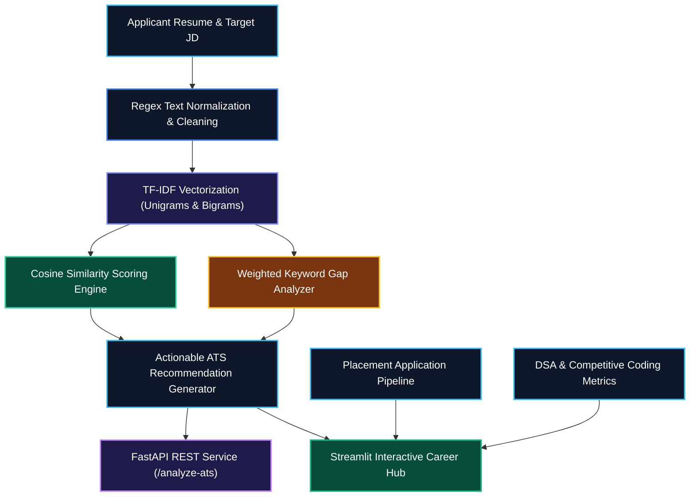

# 🎓 CampusMind — Placement & Career Intelligence Platform

<div align="center">

  

  <br/><br/>

  <a href="https://campusmind-etgz9tg66wuauygmtnx6up.streamlit.app/" target="_blank">
    
  </a>

  <br/><br/>

  
  
  
  
  
  
  

</div>

---

## 🌐 Live Interactive Deployment

Explore CampusMind through its live web application deployed on Streamlit Cloud.

**[🚀 Launch CampusMind Live Platform](https://campusmind-etgz9tg66wuauygmtnx6up.streamlit.app/)**

CampusMind helps students and job applicants evaluate resume alignment against target job descriptions, identify missing technical keywords, track placement pipelines, and visualize coding progress through an interactive dark-neon interface.

> **Note:** The live Streamlit application provides the interactive user interface, while the FastAPI module exposes REST endpoints for programmatic ATS analysis.

---

## 📌 Overview

**CampusMind** is a placement and career intelligence platform built with Python, Scikit-learn, FastAPI, and Streamlit.

During campus placements and off-campus hiring drives, applicants frequently submit strong resumes that get filtered out by automated Applicant Tracking Systems (ATS) due to missing domain-specific keywords or phrasing mismatches. CampusMind addresses this through deterministic text normalization, unigram/bigram TF-IDF vectorization, cosine similarity scoring, and weighted keyword gap analysis.

Its three core functional areas are:

- **AI Resume & JD ATS Matcher:** Quantifies alignment between a candidate's resume and a target job description while surfacing high-priority missing keywords.
- **Placement & Application Tracker:** Organizes on-campus and off-campus application stages, roles, target compensation packages, and timelines.
- **Coding Progress Analytics:** Summarizes competitive programming metrics and DSA topic coverage through interactive Plotly visualizations.

### 🎯 Project Objectives

- Normalize and clean unstructured resume and job description text.
- Compute transparent ATS compatibility scores using unigram and bigram TF-IDF cosine similarity.
- Extract matched terms and rank missing keywords by their importance weight in the target job description.
- Provide actionable resume improvement feedback based on alignment thresholds.
- Expose the ATS engine via schema-validated FastAPI REST endpoints (`/analyze-ats` and `/health`).
- Validate core NLP matching logic and API endpoints using an automated Pytest suite.
- Maintain continuous deployment availability via a scheduled GitHub Actions keep-alive workflow.

---

## 🏗️ End-to-End Pipeline & Architecture

<div align="center">

  

</div>

### System Architecture



---

## 🔧 Core Engineering Capabilities

### 1. 📄 Text Normalization & N-Gram TF-IDF Vectorization

Raw resume and job description inputs often contain inconsistent casing, punctuation, and formatting symbols.

The preprocessing and vectorization pipeline performs:

- Lowercasing and regex-based stripping of non-alphanumeric noise (`[^a-z0-9\s]`).
- Whitespace normalization and empty-input guard checks.
- English stop-word removal using Scikit-learn's `TfidfVectorizer`.
- Unigram and bigram extraction (`ngram_range=(1, 2)`) to capture both single skills (e.g., `python`, `docker`) and multi-word phrases (e.g., `machine learning`).

### 2. 🎯 Cosine Similarity & Ranked Keyword Gap Analysis

Instead of opaque scoring, CampusMind computes interpretable similarity and term-level coverage:

- **Cosine Similarity Score:** Measures angular similarity between the TF-IDF vectors of the cleaned resume and job description, scaled to a `0–100%` percentage.
- **Matched Keywords:** Identifies up to 15 domain terms present in both the job description and the candidate's resume.
- **Importance-Ranked Missing Keywords:** Extracts terms present in the job description but absent from the resume, sorted in descending order by their TF-IDF weight in the job description.
- **Tiered Recommendations:** Outputs targeted guidance across high (`>= 80%`), moderate (`50–79.99%`), and low (`< 50%`) alignment brackets.

### 3. ⚡ FastAPI Backend & Pydantic Validation

The `api/main.py` service exposes the matching engine for programmatic integration:

- **`GET /health`:** Readiness probe returning service status and HTTP 200 verification.
- **`POST /analyze-ats`:** Accepts schema-validated `ATSRequest` payloads (`resume_text`, `job_description`) and returns structured `ATSResponse` objects containing the match score, matched keywords, missing keywords, and recommendation.

### 4. 📊 Placement Pipeline & Coding Analytics Dashboard

The Streamlit frontend (`app/dashboard.py`) integrates three dedicated views under a custom dark-neon theme:

- **AI Resume & JD ATS Matcher:** Side-by-side input editors, KPI cards for match percentage and keyword counts, status alerts, and interactive keyword pills.
- **Placement & Application Tracker:** Tabular tracking view for company roles, application statuses (`Applied`, `Online Assessment`, `Interview Scheduled`, `Offer Received`), CTC packages, and dates.
- **Coding Progress Analytics:** Summary KPI metrics for LeetCode problem counts, Codeforces rating, and contest accuracy alongside an interactive Plotly bar chart breaking down problems solved across core DSA topics.

### 5. 🧪 Automated Testing & Continuous Availability

- **Unit & API Testing:** `tests/test_ats.py` verifies TF-IDF scoring and keyword extraction accuracy, while `tests/test_api.py` uses FastAPI's `TestClient` (`httpx`) to validate REST endpoints.
- **24x7 Keep-Alive Automation:** `.github/workflows/keep_alive.yml` pings the deployed Streamlit Cloud instance every 6 hours with automated retry handling to prevent container hibernation.

---

## 📊 Evaluation & Diagnostic Metrics

| Metric / Output | Purpose |
|---|---|
| **ATS Match Score (%)** | Cosine similarity between resume and job description TF-IDF vectors scaled to `0–100%`. |
| **Matched Keywords** | Top technical terms and bigrams verified in both the resume and target JD. |
| **Missing Keywords** | High-weight JD terms absent from the resume, ranked by TF-IDF importance. |
| **Alignment Tier** | Categorizes compatibility into Low (`<50%`), Moderate (`50–79%`), or Excellent (`>=80%`). |
| **API Health Status** | Verifies FastAPI service readiness via the `/health` endpoint. |

---

## 🧰 Technology Stack

| Component | Technology | Purpose |
|---|---|---|
| Programming Language | Python 3.11 | Core application logic |
| NLP & Vectorization | Scikit-learn, SciPy | TF-IDF vectorization & cosine similarity |
| Data Handling | Pandas, NumPy | Structured pipeline data & array operations |
| Web Dashboard | Streamlit | Interactive dark-neon user interface |
| Data Visualization | Plotly | Interactive DSA topic analytics |
| Backend API | FastAPI, Uvicorn, Pydantic | REST API endpoints & payload validation |
| Automated Testing | Pytest, HTTPX | Unit tests and FastAPI TestClient verification |
| CI / Automation | GitHub Actions | Scheduled 24x7 Streamlit keep-alive workflow |

---

## 📂 Repository Structure

```text
CampusMind/
├── .github/
│   └── workflows/
│       └── keep_alive.yml        # Scheduled 24x7 Streamlit Cloud keep-alive workflow
├── .streamlit/
│   └── config.toml               # Dark-neon theme configuration
├── api/
│   └── main.py                   # FastAPI application (/health and /analyze-ats)
├── app/
│   └── dashboard.py              # Multi-tab Streamlit Career Intelligence UI
├── assets/
│   ├── campusmind-banner.svg     # Animated hero banner SVG
│   └── campusmind-pipeline.svg   # End-to-end architecture pipeline SVG
├── src/
│   └── ats/
│       └── matcher.py            # Text cleaning, TF-IDF vectorization & gap analysis
├── tests/
│   ├── test_api.py               # FastAPI endpoint test suite
│   └── test_ats.py               # ATS matcher unit test suite
├── .gitignore
├── requirements.txt
└── README.md
```

---

## 💻 Local Setup & Execution

### Prerequisites

- Python 3.11
- Git
- pip
- PowerShell, Command Prompt, or Bash terminal

### 1. Clone the Repository

```powershell
git clone [https://github.com/Aditya70-creator/CampusMind.git](https://github.com/Aditya70-creator/CampusMind.git)
cd CampusMind
```

### 2. Create and Activate a Virtual Environment

**Windows PowerShell**

```powershell
py -3 -m venv .venv
.\.venv\Scripts\Activate.ps1
```

**Linux / macOS / WSL2**

```bash
python3 -m venv .venv
source .venv/bin/activate
```

### 3. Install Dependencies

```powershell
python -m pip install --upgrade pip
pip install -r requirements.txt
```

### 4. Launch the Streamlit Dashboard

```powershell
streamlit run app/dashboard.py
```

### 5. Run the Automated Test Suite

```powershell
$env:PYTHONPATH="."
pytest -v
```

### 6. Run the FastAPI Backend Server (Optional)

```powershell
uvicorn api.main:app --reload --port 8000
```

Once running, interactive Swagger documentation is available at `http://127.0.0.1:8000/docs`.

---

## 🔬 Engineering Practices

CampusMind is structured around clean software and ML engineering practices:

- **Deterministic preprocessing:** Identical regex normalization is applied to both resumes and job descriptions prior to vectorization.
- **Zero-input resilience:** Gracefully handles empty or whitespace-only inputs without raising vectorizer exceptions.
- **Modular separation:** Core NLP matching logic (`src/ats/matcher.py`) is decoupled from both the FastAPI service (`api/main.py`) and the Streamlit UI (`app/dashboard.py`).
- **Automated verification:** Both the mathematical scoring engine and HTTP REST endpoints are covered by automated Pytest checks.

---

## 🗺️ Engineering Roadmap

- [x] Regex text normalization and unigram/bigram TF-IDF ATS matcher (`src/ats/matcher.py`)
- [x] Importance-weighted missing keyword extraction and tiered recommendations
- [x] FastAPI backend with `/health` and `/analyze-ats` endpoints (`api/main.py`)
- [x] Automated unit and API test suite (`tests/test_ats.py`, `tests/test_api.py`)
- [x] Multi-tab Streamlit dashboard with custom dark-neon UI (`app/dashboard.py`)
- [x] Live deployment on Streamlit Cloud with 24x7 GitHub Actions keep-alive workflow
- [ ] Direct PDF and DOCX resume file upload parsing
- [ ] Persistent database storage for the placement application tracker
- [ ] Live LeetCode and Codeforces API profile synchronization

---

## 🤝 Contributing

Contributions, bug reports, and feature enhancements are welcome.

1. Fork the repository.
2. Create a feature branch (`git checkout -b feat/your-feature`).
3. Implement your changes and run `pytest -v`.
4. Commit and push your branch.
5. Open a Pull Request describing the updates.

---

## 📄 License

This project is released under the MIT License.

---

## 👨‍💻 Author

**Aditya Mitra**

- **GitHub:** [@Aditya70-creator](https://github.com/Aditya70-creator)
- **Repository:** [CampusMind](https://github.com/Aditya70-creator/CampusMind)
- **Live Application:** [CampusMind on Streamlit Cloud](https://campusmind-etgz9tg66wuauygmtnx6up.streamlit.app/)

---

<div align="center">

  **CampusMind**

  *Turning resume optimization and placement tracking into actionable career intelligence.*

</div>
